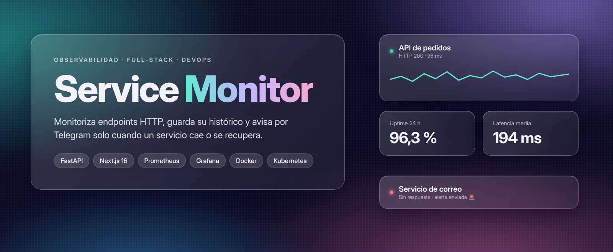
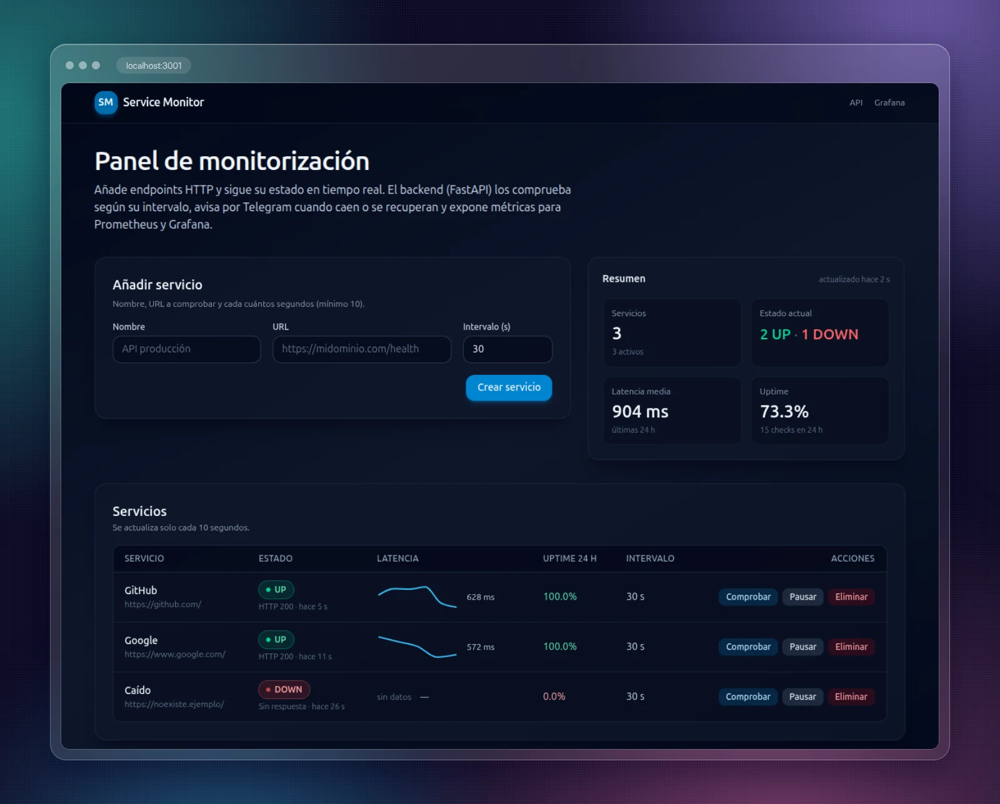
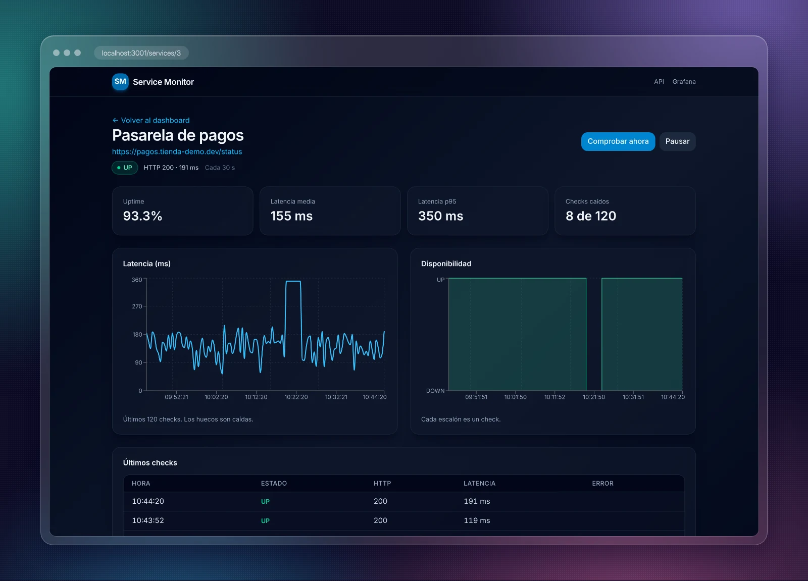
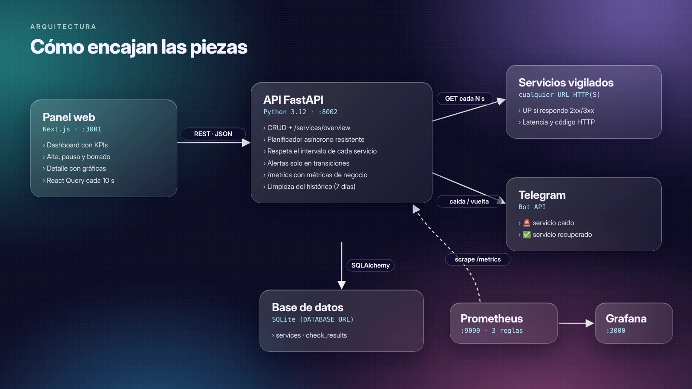
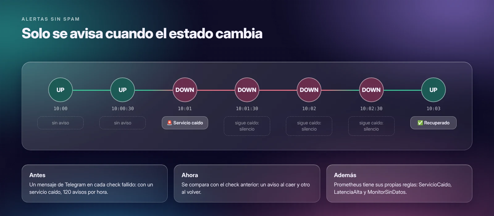

<div align="center">



[](https://github.com/hectormac35/service-monitor/actions/workflows/ci.yml)


**Un monitor de disponibilidad tipo UptimeRobot hecho desde cero:** comprueba endpoints HTTP, guarda el histórico,
calcula uptime y latencia, avisa por Telegram y expone métricas para Prometheus y Grafana.

</div>

---

## ✦ Qué hace

| | |
|---|---|
| 🛰️ **Comprueba** | Cada servicio se revisa con **su propio intervalo** (10 s – 24 h): código HTTP, latencia y error. |
| 🔔 **Avisa sin spam** | Un mensaje de Telegram **al caer** y otro **al recuperarse**, no uno en cada check fallido. |
| 📊 **Resume** | Uptime y latencia media de 24 h, mini gráfica de los últimos checks y estado en vivo. |
| 🎛️ **Se gestiona** | Alta, comprobación manual, pausa/reanudación y borrado desde el panel. |
| 📈 **Se observa** | `/metrics` con métricas de negocio, 3 reglas de alerta en Prometheus y dashboard de Grafana ya provisionado. |
| 🧹 **Se mantiene** | El histórico se limpia solo (7 días por defecto). |

## ✦ El panel



El dashboard pide todo en **una sola llamada** (`GET /services/overview`) y se refresca cada 10 s. Cada fila muestra
el estado, cuándo se comprobó, la latencia de los últimos 20 checks y el uptime de 24 h, en verde, ámbar o rojo.



En el detalle de cada servicio aparecen el uptime, la latencia media y p95, las gráficas de latencia y disponibilidad y
la tabla de los últimos checks con su error.

> Las capturas usan datos de ejemplo cargados en una base de datos local.

## ✦ Arquitectura



- **API (FastAPI)**:
  - CRUD de servicios;
  - planificador asíncrono que cada 5 s mira a qué servicios les toca comprobarse;
  - checks en paralelo, con un límite de concurrencia;
  - un error en un check no detiene el bucle.
- **Base de datos**: SQLite mediante SQLAlchemy. La ruta se configura con `DATABASE_URL`.
- **Panel (Next.js 16)**: React Query, Recharts y Tailwind 4, compilado en modo `standalone` para una imagen pequeña.
- **Prometheus + Grafana**: la API publica estas métricas:
  - `service_monitor_service_up`;
  - `service_monitor_response_time_ms`;
  - `service_monitor_checks_total`;
  - `service_monitor_alerts_total`.

  Grafana arranca con la fuente de datos y el dashboard ya cargados.

## ✦ Alertas sin spam



Cada resultado se compara con el check anterior del mismo servicio:

| Antes → ahora | Acción |
|---|---|
| UP → DOWN, o primer check caído | 🚨 alerta de caída |
| DOWN → DOWN | silencio |
| DOWN → UP | ✅ aviso de recuperación |
| UP → UP | nada |

## ✦ Puesta en marcha

```bash
git clone https://github.com/hectormac35/service-monitor.git
cd service-monitor
cp .env.example .env        # token de Telegram (opcional) y contraseña de Grafana
docker compose up -d --build
```

| Servicio | URL |
|---|---|
| Panel | http://localhost:3001 |
| API y documentación | http://localhost:8002/docs |
| Prometheus | http://localhost:9090 (pestaña *Alerts*) |
| Grafana | http://localhost:3000 (usuario `admin`, contraseña `GRAFANA_ADMIN_PASSWORD`) |

Sin token de Telegram todo funciona igual; las alertas solo quedan en el log.

### Desarrollo local

```bash
# API
python -m venv .venv && source .venv/bin/activate
pip install -r requirements-dev.txt
uvicorn app.main:app --reload --port 8002

# Panel (en otra terminal)
cd frontend && npm ci && npm run dev -- -p 3001
```

### Tests y calidad

```bash
pytest -q                          # 15 tests: API, intervalos, alertas, purga, métricas
ruff check app tests && ruff format --check app tests
cd frontend && npm run lint && npm run build   # el build también comprueba los tipos
```

La CI de GitHub Actions ejecuta todo esto, valida `docker compose` y las reglas de Prometheus, y publica las dos
imágenes en GHCR al hacer push a `main`.

## ✦ API

| Método | Ruta | Descripción |
|---|---|---|
| `GET` | `/services/` | Lista de servicios |
| `POST` | `/services/` | Crear (`name`, `url`, `check_interval_seconds` ≥ 10) |
| `GET` | `/services/overview` | Servicios con último estado, uptime/latencia 24 h y últimos 20 checks |
| `GET` · `PATCH` · `DELETE` | `/services/{id}` | Ver, editar o pausar (`is_active`), borrar con su historial |
| `POST` | `/services/{id}/check` | Comprobar ahora |
| `GET` | `/services/{id}/status` | Último resultado |
| `GET` | `/services/{id}/history?limit=50` | Histórico en orden cronológico |
| `POST` | `/services/test-notification` | Mensaje de prueba a Telegram (máx. 1/min) |
| `GET` | `/healthz` · `/metrics` | Salud y métricas |

## ✦ Configuración

| Variable | Por defecto | Para qué |
|---|---|---|
| `DATABASE_URL` | `sqlite:///./data/service_monitor.db` | Base de datos |
| `CORS_ORIGINS` | `http://localhost:3001,http://localhost:3000` | Orígenes permitidos del panel |
| `SCHEDULER_TICK_SECONDS` | `5` | Cada cuánto mira el planificador qué toca comprobar |
| `MAX_CONCURRENT_CHECKS` | `10` | Checks simultáneos |
| `CHECK_TIMEOUT_SECONDS` | `10` | Timeout de cada petición |
| `HISTORY_RETENTION_DAYS` | `7` | Días de histórico (0 = sin límite) |
| `TELEGRAM_BOT_TOKEN` / `TELEGRAM_CHAT_ID` | — | Alertas por Telegram |

## ✦ Kubernetes

```bash
kubectl create secret generic service-monitor-telegram \
  --from-literal=TELEGRAM_BOT_TOKEN=... --from-literal=TELEGRAM_CHAT_ID=...   # opcional
kubectl apply -k k8s/
kubectl port-forward svc/service-monitor 8002:80
```

El Deployment usa **una réplica con estrategia `Recreate`** y un PVC. Hay una razón: el planificador vive dentro del
proceso y la base de datos es SQLite. Con dos réplicas, cada pod comprobaría los mismos servicios y enviaría alertas
duplicadas.

## ✦ Decisiones técnicas

- **Planificador propio con `asyncio`** en vez de APScheduler. Es una sola tarea que revisa el intervalo de cada
  servicio, se arranca y se para con el `lifespan` de FastAPI y no muere si un ciclo falla.
- **Alertas por transición**: se compara con el check anterior, así que no hace falta guardar más estado.
- **Un endpoint `overview`** para el dashboard. Evita una petición por servicio y que el usuario tenga que pulsar un botón
  para ver el estado.
- **Métricas de negocio en Prometheus** además de las HTTP. Así las alertas no dependen solo de Telegram.

## ✦ Próximos pasos

- PostgreSQL y un planificador separado de la API, para escalar a varias réplicas.
- Autenticación para las operaciones de escritura.
- Checks de palabra clave en la respuesta y de caducidad de certificados TLS.

---

<div align="center">

Hecho por **Héctor Macarrilla** · [Portfolio](https://hectormac35.github.io/portfolio/) · [GitHub](https://github.com/hectormac35)

</div>
